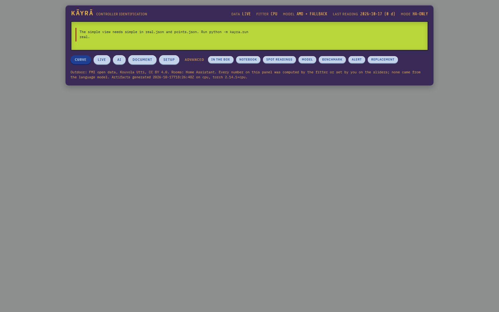

# Käyrä

Käyrä works out what an undocumented controller is doing from data a site already logs. No vendor, no manual, no bump test, nothing written to the controller.

Factories and buildings are full of controllers nobody has documentation for. The proof of concept here is a real district heating substation (two heating loops, one commercial controller) on a real building in Kouvola, Finland. Home Assistant room sensors and FMI outdoor temperature in. The controllers' outputs are never logged, so they are identified through the building.

AMD Developer Hackathon ACT III, Track 1 Intelligent Industry. Live panel: [fill: public URL]. Video: [fill: YouTube URL].



## What runs where

- **Language model: AMD token factory**, DeepSeek-V4.1-Flash, chosen by `tools/llm_check.py` (scores the endpoint's models on Käyrä's own tasks, graded by code). When AMD times out or rate-limits, the call falls back to the same model on OpenRouter. Every call is archived with the endpoint that actually answered, and the panel shows the mix.
- **Fitter: PyTorch.** Device picked at runtime (`cuda` on ROCm, else CPU). No AMD GPU was available for this build, so the numbers are from a laptop CPU. The GPU row of the benchmark says NOT MEASURED; no estimate is given.
- **Live data:** the panel server reads Home Assistant now (LAN first, then the external URL) and FMI now. The status line says LIVE, LIVE OUTDOOR or REPLAY, whichever is true.

## Run it

Python 3.11+.

```
python -m venv .venv
.venv\Scripts\pip install -r requirements.txt
.venv\Scripts\python tools\pull_ha.py          # read Home Assistant history (needs HA_URL / HA_URL_EXT, HA_TOKEN in .env)
.venv\Scripts\python -m kayra.run all          # real data, synthetic benchmark, timing, model steps
.venv\Scripts\python -m kayra.evaluate         # grade against the configured curve (the only code that reads it)
.venv\Scripts\python tools\dev_server.py       # panel on http://localhost:8201
```

Smaller pieces: `kayra.run real --quick` (smoke test), `kayra.run simple` (home-screen curve only), `kayra.run ai` (model steps only). Without a model configured, the hypothesis loop uses hand-written stand-in programs from `kayra/standin/` and labels them so everywhere. `.env.example` lists every setting.

## Not just houses: configure the process

What Käyrä watches is configuration, not code:

- `config/process.json` lists the sources and signals: role (input, output, aux, reference), unit, source and tag. Here: FMI outdoor as input, three rooms as outputs, humidity as aux, panel readings as reference. Planned sources (OPC UA, Modbus TCP, MQTT, historian CSV) are in the file and on the panel's Setup screen, marked planned.
- `config/site.json` is operator knowledge: which outputs share one controller (groups), and notes. Groups share one controller program in the fit; each output keeps its own process parameters.
- `config/menu_labels.md` holds the labels of the controller's menus, labels only.

A process line, an HVAC plant or a cooling loop is a different `process.json`. The structure language, fitter and model loop do not change. Domain catalogues and parameter bounds per signal type are the next step and listed as planned.

## How it works

The process per output, per hour (here a room):

```
T[t+1] = T + a*(T_out - T) + h*max(S - T, 0) + gains(hour)
```

`S` is what the controller stack asks for (here supply water temperature). Käyrä never sees it.

Every hypothesis about the controller is a short program in a small structure language (`kayra/dsl.py`), for example a weather curve with summer cutoff:

```
where(ema(T_out, tau) < cutoff, level + slope * T_out, OFF)
```

The language has no numeric literals. Every number is a typed parameter and the fitter finds the value. That is how "no number came from the language model" still holds when the model writes code.

- `kayra/search.py`: cross-entropy search over thousands of parameter sets, all simulated together as tensors over 72-hour windows, scored on held-out weeks. Process loss comes from the summer, when the heating is off.
- `kayra/structures/`: seed catalogue S0-S7 (free-floating, linear curve, clamped curve, curve with cutoff, PI on the output, on/off thermostat, curve with feedback, curve with night setback).
- `kayra/hypothesize.py`: the model reads what the best program fails to explain and proposes new programs. Same validator, same fitter. Rejected programs go back once with the reason. Everything lands in a lab notebook.
- `kayra/baseline_search.py`: the non-LLM baseline, random grammar edits with the same operators and budget.
- `kayra/context.py`: the model reads operator notes and menu labels and writes each as a complete control law for a named output or group, which the fitter scores against the blind best. From "outdoor temperature delay", "autumn drying", "max limit" and "min limit" it writes the controller's documented setpoint structure. A fitter cannot read a menu.
- `kayra/writeup.py`: the model writes the as-found specification from the computed evidence, plus a short summary in Finnish for the technician. `kayra/explain.py`: diagnosis and next observation. Both go through `guardrails.py`: a line with a number that is not in the evidence is dropped.
- `kayra/reference.py`: panel readings, used to grade and as optional spot anchors.
- `kayra/evaluate.py`: the only code that opens `data/manual/ouman_curve_setting.csv`, the configured curve. In the git history it arrives after the fits. The coding agent never opened it and read only error numbers.

## Results (run of 2026-10-17, room data 2026-04-13 to 2026-10-17)

Real house, from room data alone:

- **Upstairs (kitchen, floor heating):** a nearly flat supply, about 26 °C regardless of outdoor, clearly beats no control (ΔBIC 28.5). Held-out room error 0.69 °C.
- **Downstairs (fireplace room + TV room, radiators):** a weather curve with slope -1.07 °C/°C and a summer stop at 13.8 °C fits, but no control scores slightly better (ΔBIC -6). Not established. The TV room takes 11 % of the group's heating coupling, consistent with its almost-closed valve. On cold weeks alone the TV room ranks PI first, and that valve is a real local feedback.
- **Spot readings:** error against the panel readings not used drops from 12.3 °C (none) to 2.2 °C (three).
- **Operator belief "L2 is L1 minus a few degrees":** refuted by the panel's own readings (the gap widens when it gets colder).

Blind evaluation against the configured curve (`kayra/evaluate.py`):

- The configured curves agree with the panel's own readings (L1 0.46 °C, L2 0.49 °C): the file is consistent.
- Identified curve vs configured L1: 15.9 °C off from room data alone, 2.9 °C with three spot readings. The uncertainty band contained the configured curve in at most 1 of 8 points: too narrow.
- Which floor does L1 heat? Nobody knew. The product's spot-reading test leans upstairs (margin 0.084 °C of room error). The evaluation by curve slope says downstairs (margin 1.08 °C/°C). They disagree, so it is not settled. A hand on the two supply pipes would settle it.

Synthetic controllers hidden in the real building model, three arms with the same fitter:

| | Catalogue | + grammar search | + language model |
|---|---|---|---|
| Lowest held-out error (6 cases, ties count) | 2 | 2 | 6 |
| Right mechanism by the checklist fixed before the runs | 1 | 1 | 1 |

The model arm used fewer fits than grammar search. Some of its wins come from `month()` terms that follow seasonal drift rather than the hidden mechanism. On H6 it wrote the thermostat with explicit room thresholds instead of the `hysteresis` operator, which the literal checklist does not count.

Site context: from the menu labels alone the model wrote the controller's setpoint structure (curve on delayed outdoor, autumn drying, min and max limits). Every such program scored worse than the best program found without context (ΔBIC +15 to +24). The room data cannot support that much structure yet.

Model calls: AMD token factory (DeepSeek-V4.1-Flash) where it answered in time, OpenRouter fallback otherwise. The mix is in `artifacts/real.json` and `synth.json` (`meta.llm`), and every call is in `artifacts/llm_archive.jsonl`.

Fitter: 163,840 candidates over the eight catalogue programs in 56 s on one CPU thread, 32 s on six (Intel laptop CPU). AMD GPU not measured.

## Deploy

[docs/DEPLOY.md](docs/DEPLOY.md): one Python process plus a Cloudflare tunnel on any always-on box; it reads Home Assistant through its external URL. Prompt for an agent in [docs/OPENCLAW_DEPLOY_PROMPT.md](docs/OPENCLAW_DEPLOY_PROMPT.md). Vercel works as a replay-only mirror.

## Limits

- Structure discovery is tested on synthetic controllers inside the real building model. The language model did not beat plain grammar search there. On the real stack it is one data point.
- From room data alone the curve slope is identifiable and the level only loosely. Spot readings pin the level. Both modes are labelled. The uncertainty band is too narrow: it misses the configured curve more often than a 90 % band should.
- Controllers with an integrator are hard to identify from windows: the integrator state does not show in output data that sits near setpoint.
- Model prose: numbers are checked against the evidence, reasoning is not. The panel shows the computed diagnosis first.
- Which floor each panel loop serves was not known; the data's answer is weak.
- Winter is unobserved. No extrapolation below the observed outdoor range.
- Outdoor comes from FMI Utti, several km away. The controller's own sensor read 0.2 to 1.1 °C warmer in six checks.
- Not in this version: room coupling, the replacement controller, editing the setup in the panel, connectors beyond Home Assistant and FMI.
- An earlier automated data inventory (another agent, 2026-10-03) was fabricated. Every figure here was recomputed from files on disk.

Data: FMI open data, CC BY 4.0. Code: MIT.
